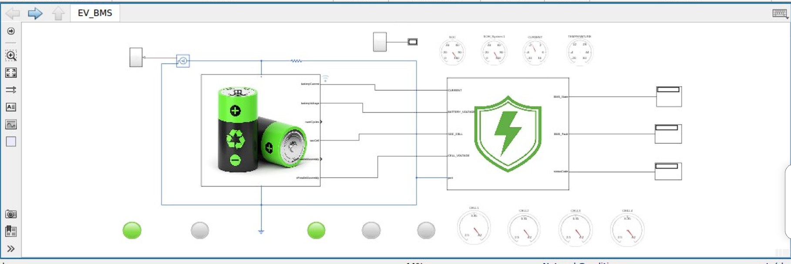
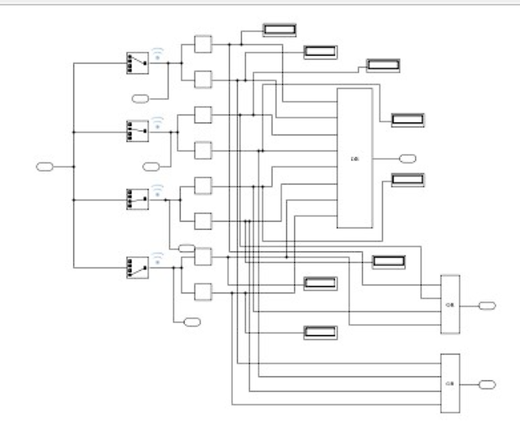
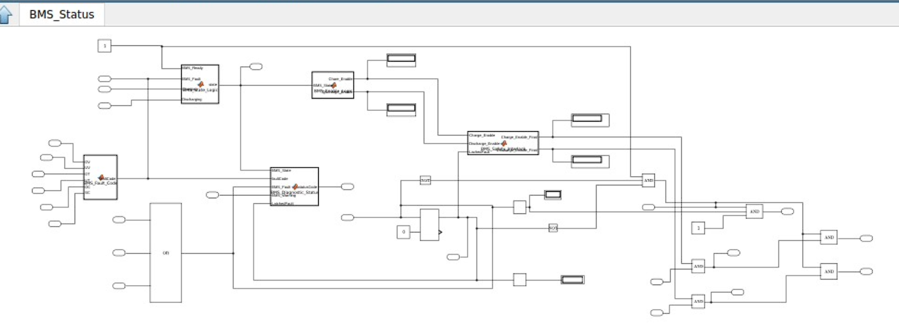

# 🔋 EV Battery Management System (BMS)

[](https://github.com/himanshukumar4751/EV-Battery-managment-system)

### Model-Based Design, Protection & Monitoring using MATLAB/Simulink

<p align="center">

**⚡ A Model-Based EV Battery Management System for Battery Monitoring, Protection, Control & Diagnostics**

</p>

---

## 🚗 Project Overview

This project presents a **model-based Battery Management System (BMS)** developed and simulated using **MATLAB/Simulink**.

The objective is to model the essential functions of an EV BMS, including **cell voltage monitoring, battery current monitoring, temperature monitoring, State of Charge (SOC), State of Health (SOH), fault detection, protection logic, contactor control, charging/discharging control, and thermal management requests**.

The model is designed with a modular control architecture to demonstrate how a BMS monitors battery conditions and makes real-time protection and control decisions.

---

## 🎯 Project Objectives

* 🔋 Monitor individual battery-cell voltages
* ⚡ Monitor battery current
* 🌡️ Monitor battery temperature
* 📊 Estimate State of Charge (SOC)
* ❤️ Estimate State of Health (SOH)
* 🛡️ Detect abnormal battery operating conditions
* 🚨 Generate BMS fault codes
* 🔌 Control battery charge/discharge permission
* 🔄 Control the main battery contactor
* ❄️ Generate cooling requests
* 📟 Provide real-time BMS status information
* 🧩 Demonstrate Model-Based Design using Simulink

---

## 🏗️ System Architecture

The overall BMS workflow can be represented as:

```text
              🔋 EV Battery Pack
                     │
                     ▼
          📡 Battery Measurements
                     │
        ┌────────────┼────────────┐
        ▼            ▼            ▼
   Cell Voltage    Current     Temperature
        │            │            │
        └────────────┼────────────┘
                     ▼
              🧠 BMS Controller
                     │
        ┌────────────┼────────────┐
        ▼            ▼            ▼
      SOC/SOH    Fault Detection  Diagnostics
        │            │
        └────────────┼────────────┘
                     ▼
             🛡️ Protection Logic
                     │
        ┌────────────┼────────────┐
        ▼            ▼            ▼
   Charge Enable  Discharge     Contactor
                  Enable         Control
                     │
                     ▼
              ❄️ Thermal Request
```

### Simulink Model



---

## 🔋 Cell Voltage Monitoring

The BMS continuously monitors individual cell voltages to identify abnormal conditions such as:

* 🔺 Over-voltage
* 🔻 Under-voltage
* ⚠️ Cell imbalance
* 🚨 Unsafe battery operating conditions

### Cell Voltage Visualization



The visualization provides an easy-to-understand representation of individual cell voltage measurements.

---

## 🛡️ BMS Protection & Status Monitoring

The BMS monitors battery operating conditions and generates appropriate protection and diagnostic signals.

### Protection Functions

| Protection           | Purpose                               |
| -------------------- | ------------------------------------- |
| 🔺 Over-Voltage      | Protect cells from excessive voltage  |
| 🔻 Under-Voltage     | Prevent excessive cell discharge      |
| ⚡ Over-Current       | Protect against excessive current     |
| 🌡️ Over-Temperature | Prevent thermal damage                |
| ❄️ Cooling Request   | Request thermal management            |
| 🔌 Contactor Control | Safely connect/disconnect the battery |
| 🚨 Fault Detection   | Identify abnormal conditions          |

### BMS Status Visualization



The BMS status interface provides information such as:

* **BMS State**
* **Fault Code**
* **Status Code**
* **Charge Permission**
* **Discharge Permission**
* **Main Contactor Status**
* **Cooling Request**

---

## 📊 Battery Parameters Monitored

```text
🔋 Cell Voltage
⚡ Battery Current
📈 State of Charge (SOC)
❤️ State of Health (SOH)
🌡️ Battery Temperature
🚨 Fault Status
🔌 Contactor Status
❄️ Cooling Request
```

---

## ⚙️ Main BMS Signals

The model includes control and monitoring signals such as:

```text
Charge_Final
Discharge_Final
Main_Contactor
Cooling_Request
```

These signals represent the BMS decision-making layer for battery operation and protection.

---

## 🧠 Model-Based Design Approach

The project follows a Model-Based Design workflow:

```text
📋 Requirements
      ↓
🧮 Mathematical / Logical Model
      ↓
🧩 Simulink Implementation
      ↓
🔬 Simulation
      ↓
📊 Monitoring & Visualization
      ↓
🛡️ Protection Verification
```

MATLAB/Simulink is used to develop, simulate, visualize and verify the BMS control logic.

---

## 🧪 Simulation & Verification

The model can be evaluated under different battery operating conditions, including:

* Normal operation
* Charging
* Discharging
* Cell over-voltage
* Cell under-voltage
* Over-current
* Over-temperature
* Fault conditions
* Contactor operation
* Cooling request conditions

The objective is to verify that the BMS responds correctly when battery operating conditions move outside safe limits.

---

## 🛠️ Tools & Dependencies

| Category              | Technology                   |
| --------------------- | ---------------------------- |
| 🧮 Modeling           | MATLAB                       |
| 🧩 Simulation         | Simulink                     |
| 🔋 Application        | EV Battery Management System |
| 🛡️ Control           | BMS Protection Logic         |
| 📊 Visualization      | Simulink Monitoring          |
| 🔬 Development Method | Model-Based Design           |

**Note:** As this is a MATLAB/Simulink model, there are no package manager dependencies (like npm or pip) to install. Please ensure you have MATLAB and the required Simulink toolboxes installed to run this project.

---

## 📁 Repository Structure

```text
📁 EV-BMS-MATLAB-Simulink
│
├── 📄 README.md
├── 📄 LICENSE
├── ⚙️ EV_BMS.slx
├── 🖼️ BMS_Model.png
├── 🖼️ Cell_Voltage.png
└── 🖼️ BMS_Status.png
```

---

## 🚀 How to Run

1. 📥 Download or clone this repository.
2. 💻 Open MATLAB/Simulink.
3. 📂 Open `EV_BMS.slx`.
4. ▶️ Run the simulation.
5. 📊 Observe the BMS monitoring signals.
6. 🚨 Test different fault and operating conditions.

> **Note:** The model may require the appropriate MATLAB/Simulink release and any required MathWorks products used by the model.

---

## 🌱 Future Development

The project can be further extended toward an automotive-grade BMS architecture by adding:

* 🔄 Active/Passive Cell Balancing
* 🧠 Advanced SOC Estimation
* ❤️ Improved SOH Estimation
* 🌡️ Detailed Thermal Model
* 📡 CAN Communication
* 🧪 Fault Injection & Automated Testing
* 🔐 Functional Safety Concepts
* ⚙️ Stateflow-Based BMS State Machine
* 🔋 Larger Battery Pack Models
* 🖥️ Advanced BMS Dashboard
* 🚘 Integration with an EV powertrain model

---

## 🎓 Learning Outcomes

This project provides practical experience in:

* Battery modeling
* BMS architecture
* Battery protection
* SOC/SOH concepts
* Simulink modeling
* Model-Based Design
* Fault detection
* Control logic
* EV battery monitoring
* Simulation and verification

---

## 👨‍💻 Project

**EV Battery Management System — Modeling, Protection & Monitoring**

**Focus:** Electric Vehicles • Battery Management Systems • MATLAB/Simulink • Model-Based Design • Battery Protection • EV Control

---

## ⚠️ Disclaimer

This project is intended for **educational, simulation and portfolio purposes**. It should not be considered a production-ready automotive BMS without appropriate hardware validation, safety analysis, testing, calibration and automotive functional-safety processes.

---

## ⭐ Support

If you find this project useful for learning about EV BMS development, consider giving the repository a ⭐.

**Built with ⚡ MATLAB + Simulink for the future of electric mobility.**
